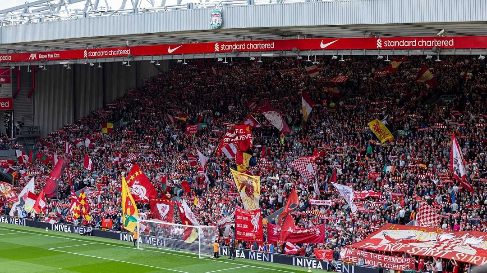
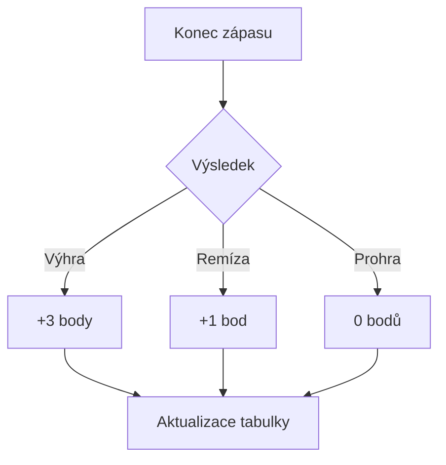

# 🔴 Liverpool FC: profil klubu



*Obrázek: vlastní banner k tomuto profilu (bez oficiálního loga klubu).*

## 📖 Úvod

**Liverpool FC** je anglický fotbalový klub z města Liverpool, který hraje na stadionu **Anfield**. Fanoušci mu říkají **The Reds** a jeho heslem je **You'll Never Walk Alone**. ~~Nejsem zaujatý.~~ *(Jsem. Úplně.)*

### 🏟️ Základní údaje

- **Založen:** 1892
- **Stadion:** Anfield
- **Přezdívka:** The Reds
- **Barvy:** červená

### 🧠 Proč zrovna Liverpool

*Vnitřní hlas: „Protože když se hraje dobrý fotbal, nemůže to být jiný klub.“* Tenhle profil shrnuje historii, největší úspěchy a pár zajímavostí, které se hodí znát.

## 🏆 Největší úspěchy

1. Mistr Anglie (**20 titulů**)
2. Vítěz evropského poháru mistrů a Ligy mistrů (**6×**)
3. Vítěz FA Cupu a Ligového poháru

### 📊 Přehled trofejí

| Soutěž                          | Počet titulů | Poznámka                          |
|---------------------------------|:------------:|-----------------------------------|
| Mistr Anglie                    | 20           | Nejvyšší anglická soutěž          |
| Liga mistrů / Pohár mistrů      | 6            | Poslední titul v roce 2019        |
| Pohár UEFA / Evropská liga      | 3            | Evropská druhá liga               |
| FA Cup                          | 8            | Anglický národní pohár            |
| Ligový pohár                    | 10           | Zároveň rekord soutěže            |

*Počty trofejí se v čase mění, proto si je před odevzdáním ověř na oficiálním webu klubu.*

### ✅ Můj fanouškovský úkolovník

- [x] Naučit se text písně *You'll Never Walk Alone*
- [x] Sledovat zápas Liverpoolu v televizi
- [x] Znát základní historii klubu
- [ ] Navštívit Anfield osobně
- [ ] Koupit si dres
- [ ] Vidět Liverpool hrát živě v Praze

## 💻 Statistiky v kódu

Jednoduchý Python skript, který spočítá body v tabulce podle výsledků:

```python
def body(vyhry, remizy):
    """Za výhru jsou 3 body, za remízu 1 bod."""
    return 3 * vyhry + remizy

vyhry = 25
remizy = 9
prohry = 4

print(f"Body: {body(vyhry, remizy)}")
print(f"Zápasů celkem: {vyhry + remizy + prohry}")
```

A krátká ukázka v JavaScriptu:

```javascript
const klub = { nazev: "Liverpool FC", stadion: "Anfield", zalozen: 1892 };
console.log(`${klub.nazev} hraje na stadionu ${klub.stadion}.`);
```

## 🔬 Bonus: matematika a diagram

### 🧮 Výpočet bodů

Počet bodů klubu v sezóně spočítáme ze vzorce, kde $V$ je počet výher a $R$ počet remíz:

$$B = 3V + R$$

Podíl vítězství v sezóně vyjádříme jako:

```math
p = \frac{V}{V + R + P} \cdot 100\ \%
```

### 🔀 Co se stane po zápase



## 🔗 Užitečné odkazy

- [Oficiální web Liverpool FC](https://www.liverpoolfc.com/)
- [Liverpool FC na Wikipedii](https://cs.wikipedia.org/wiki/Liverpool_FC)
- [Návod na psaní Markdownu na GitHubu](https://docs.github.com/en/get-started/writing-on-github/getting-started-with-writing-and-formatting-on-github/basic-writing-and-formatting-syntax)

---

